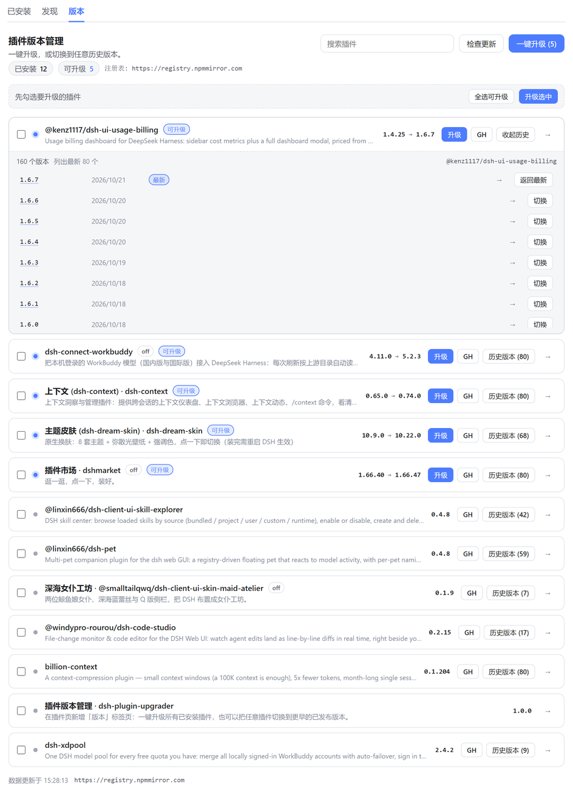
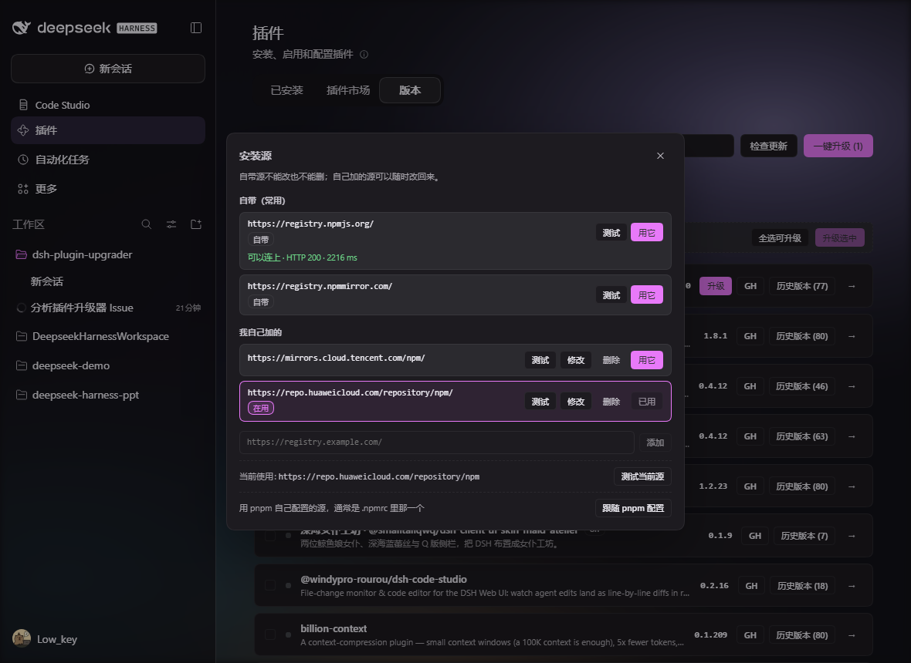
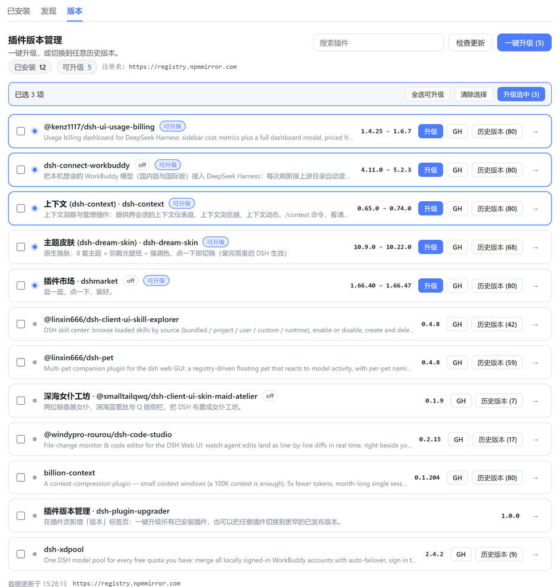

# dsh-plugin-upgrader

[](https://www.npmjs.com/package/dsh-plugin-upgrader)
[](./LICENSE)

> One-click upgrades plus version history and rollback for the DeepSeek Harness
> **Plugins** page.

DSH's built-in Plugins page installs, removes and lists plugins, but two things are
missing: upgrading everything at once, and going back to an older version. This
plugin adds a **Versions** tab to that page and fills both gaps.

English · [中文](./README.md)



## Features

- **One-click upgrade** — bump every upgradable plugin to its newest version, with
  progress, per-plugin results and failure reasons.
- **Upgrades never unload the plugin** — a version replacement happens in place
  (see below), so the plugin is not torn down and reinstalled.
- **Progress you can actually see** — the raw pnpm output (registry retries, lockfile
  verification), a live elapsed clock per step, an indeterminate bar while a step
  runs, and a cancel button that works.
- **Multi-select upgrade** — tick any subset of plugins and upgrade only those.
- **Version history / rollback** — expand any plugin to see every published version
  (with publish date and engine requirement) and switch to it in one click.
- **GitHub links** — the `GH` button opens the plugin's repository; clicking a
  version number opens that version's GitHub release page.
- **A lagging mirror is named** — versions published upstream but not yet mirrored
  are listed separately instead of the row pretending to be current.
- **Pick your own source** — switch the npm registry from the top of the Versions tab
  (official, the mainland mirror, or an address you type). The version list is re-read
  from the new source immediately and installs follow it; the choice is written to the
  profile, so it survives a restart and is the same in every browser.
- **Manage sources in a dialog** — the Registry button opens a dialog listing the
  built-in sources, the ones `pluginManager` is configured with, and the ones you added.
  Built-ins cannot be edited or deleted; your own can. Every row can be tested on its
  own, and so can the source currently in use.
- **It tells you how to restart when a restart is needed** — when a result comes back
  `restart-required`, the banner grows a "Restart DSH" button. It explains why this
  particular change has to wait and gives the one action that actually finishes the
  restart for the way you started the host: quit and reopen the desktop app, or paste
  back the command a terminal start used. After you confirm, it watches the host's pid
  and reloads only once a different process answers, instead of leaving you guessing.



> **Changing this repo? Read [AGENTS.md](./AGENTS.md) first.** It lists the behaviour
> that already works and must keep working, with the code location and the test that
> guards each one. Two of those features (the `GH` links and the in-place upgrade)
> have already been lost once by accident.

## Where it shows up

A **Versions** tab appears next to *Installed* and the market tab on the Plugins
page (that tab is **Market** with `dshmarket` installed, and **Discover** in DSH's
own market page):

- Header counts: upgradable / installed / version count
- The header **Registry** control opens the source dialog:
  - built-in sources (official registry, mainland mirror): switch to and test, never edit
    or delete
  - sources from `pluginManager`: use one directly, or keep it in your own list
  - sources you added: edit and delete; deleting the one in use falls back to
    *Follow pnpm's config*
  - **Test** on a row asks `/-/ping` and the registry root at the same time and keeps
    whichever answers first, with a 5 s budget for the whole probe (a sequential probe
    reported mainland mirrors as unreachable — their `/-/ping` can take 15 s while the
    root answers in 0.3 s), and shows the verdict under that row
  - the footer's *Follow pnpm's config* keeps pnpm's own registry (usually `.npmrc`)
- **Upgrade all** handles every upgradable plugin; the selection bar below handles
  **Upgrade selected**
- **Check for updates** bypasses the 5-minute registry cache
- The search box filters by package name
- One row per plugin; **history (n)** expands the full version list
- `GH` opens the repository homepage (hidden for plugins without one)
- Each version number is itself a link to GitHub:
  - the version was tagged → `releases/tag/v<version>` (the tag list is consulted, so
    a guessed, dead link never reaches the page)
  - the version was not tagged, or the GitHub list is unreadable (rate limit,
    offline) → the repository's `releases` feed



## Install

Search `dsh-plugin-upgrader` on the Plugins page's market tab (**Discover** in DSH
itself, **Market** with `dshmarket` installed) and hit install.
On the desktop app use its own plugin manager — the CLI cannot change the profile
an app has open.

With the `dsh` CLI (swap `web` for your profile name):

```bash
dsh plugin --profile web add dsh-plugin-upgrader
```

From source:

```bash
git clone https://github.com/zuwenyin/dsh-plugin-upgrader.git
cd dsh-plugin-upgrader
dsh plugin --profile web add "$PWD"
```

Open the Plugins page and the **Versions** tab is there. No build step, no restart.

## How it works

A browser tab cannot read the profile's dependency list and cannot reliably reach
npm (CORS, private registries, tokens), so every package operation happens on the
host half:

| Route | Purpose |
| --- | --- |
| `GET /api/plugin-upgrader/overview` | installed plugins plus their published versions (registry packument, 5-minute cache, 20-second timeout, at most 4 concurrent) |
| `POST /api/plugin-upgrader/job` | queue a batch of upgrade / switch steps, return a job id immediately |
| `GET /api/plugin-upgrader/job?id=…` | poll progress, current phase, elapsed time, per-plugin results and the live log |
| `POST /api/plugin-upgrader/cancel` | abort the step in flight, whichever install is running |
| `GET /api/plugin-upgrader/host` | this process's pid and how it was started, for the "restart DSH" dialog |

Every route is loopback-only: a batch installs packages, so a paired remote device
or a cross-site page must never reach it.

### Why an upgrade does not unload the plugin

`pluginManager.installBundle` refuses a spec that names an already-installed
dependency (`already-installed`), so pnpm never runs. The order is therefore:

1. **Install directly first.**
2. When that is refused, drop the dependency entry from the profile `package.json`
   (journal first) and install again — pnpm writes the new version back, the plugin is
   **not unloaded**, the loader keeps its instance, and no enabled state has to be
   restored.
3. Only when step 2 declines (unreadable manifest, failed install, refusal) does the
   old remove + install path run. The previous version is reported back so the UI can
   warn about a downgrade.

> The code shipped in 1.2.0, but on the desktop app it **never actually ran** between
> 1.2.0 and 1.4.0: `profileDirFrom()` only knew `DSH_PROFILE_DIR` / `DSH_HOME` +
> `DSH_PROFILE`, and the desktop shell exports none of them (it starts the host with
> the profile directory as its working directory), so step 2 bailed on its first line
> and every upgrade quietly took the remove + install path. 1.4.1 added the working
> directory fallback. See item 2 of [AGENTS.md](./AGENTS.md).

### An interrupted upgrade repairs itself

Step 2 edits the profile `package.json` inside the window where the dependency entry is
gone and the new version is not written yet. A process killed in that window leaves the
plugin out of the manifest — uninstallable in effect. So a journal
(`package.json.upgrader-journal.json`) is written before the drop: the next plugin load
reads it, restores the entry when the manifest really lacks it, merely clears the record
when the install landed, and ignores a record that no longer describes the manifest.
A failed repair only logs; it never stops the tab from loading.

### Preserving the enabled flag

Removing a plugin drops its enabled / disabled state, so any step that really removes
one re-applies `setBundleEnabled` with the state it had before the upgrade. A disabled
plugin stays disabled after being upgraded.

### Why an upgrade sometimes takes minutes

Not this plugin: pnpm. Before installing, pnpm 11 re-checks every lockfile entry
against the registry (`Verifying lockfile against supply-chain policies`), and a
mirror such as `registry.npmmirror.com` answers `ETIMEDOUT` for plenty of packages,
which starts a 10-second → 1-minute retry ladder. The fallback path that really removes
and reinstalls costs two pnpm runs.

The old build showed nothing during that time and moved the bar once per completed
step, so it read as a hang. The host now subscribes to
`plugin-manager/install-log` and `plugin-manager/install-state` and streams pnpm's
own output, the phase and the retry count into the job log, while the panel shows an
elapsed clock and an indeterminate bar — a slow install looks like a retrying one
instead of a frozen 0%.

There are four phases: `verifying` (checking the lockfile) → `installing` →
`applying` / `cancelling`. The lockfile line can sit unchanged for minutes and reads
exactly like a hang, which is why it gets a phase name of its own.

Two related bugs fixed with it:

- The heartbeat is a timer (2 s), no longer a write per completed step. A single step
  lasting over 15 minutes used to be declared abandoned, cancelling a healthy job and
  letting a second batch start on the same profile.
- The reinstall on the fallback path passed `requestId: undefined`, making that
  stretch uncancellable. Every install now has its own id, so cancel works throughout.

### A writer-lock timeout in plain words

The harness serializes writers of the profile `package.json` through a sibling
`package.json.lock`. The manager's own budget is 120 seconds, while `atomic-write`
defaults to 2 seconds for a caller that states none, so this shows up:

```
atomic-write: timed out waiting for the writer lock at …/package.json.lock
```

That sentence names a file and a pid and nothing a reader can act on. The failure now
reads the lock first and says either "another operation is rewriting it, retry once it
finishes" or "the lock was never released, restarting DSH clears it", keeping the
original in brackets so it stays searchable.

### Its own row cannot upgrade itself

The first thing the batch path does is uninstall, and that would unload the very code
running it. So *Upgrade all* never includes this plugin, and its own row goes through
the Plugins page's own installer instead; a page that offers no install entry says so
rather than showing a button that cannot work.

### One batch at a time

The host runs one job at a time. A second submission gets `409 busy` with the id of
the job that is running, and the UI **adopts** that batch instead of showing an
error:

- opening a second Plugins tab, or clicking *Upgrade all* while a batch runs, shows
  the running batch
- `overview` carries an `active` field, so a freshly mounted tab reconnects to work
  in progress
- a job re-stamps a heartbeat every 2 seconds; a job left behind by a host restart is
  declared abandoned once the heartbeat goes stale, so it cannot block every later
  upgrade with a permanent `busy`

A restart interrupts the job in flight; the UI reports that as a failure rather than
spinning forever.

## Permissions, dependencies and external services

This section states the capabilities the plugin actually uses, so a review or a bug
report does not have to read the source to find out.

### What it touches

| Capability | Scope | Notes |
| --- | --- | --- |
| Files | **the profile directory only** | Reads and writes `package.json`, writes `package.json.upgrader-journal.json`, reads `package.json.lock`. No filesystem walking, nothing outside the profile |
| Network (outbound) | the configured npm registry, the GitHub API | `GET` only, see below |
| Commands | **none** | No `child_process`, no spawned processes; installs go through the host's `pluginManager` |
| Credentials | **none** | No tokens, no `.npmrc` reads, no authentication. Private registries rely on pnpm's own configuration |

The registry choice (`registry` / `customRegistries`) is written into the profile's
`cordis.patch.yml` by the **host's settings service**, not by the plugin editing files:
the plugin only calls `configForms.set()`.

Three environment variables are read, all to *locate the profile directory*:
`DSH_PROFILE_DIR`, `DSH_HOME` and `DSH_PROFILE`. When the desktop shell exports none of
them, a working directory that parses as a profile is used instead. They are not
secrets, but a bare `process.env` counts as one "credentials" signal in a static scan,
so the real purpose is spelled out here.

### External services

| Target | Purpose | On failure |
| --- | --- | --- |
| `{configured npm registry}/{package}` | packument fetch, to list published versions (5 minute cache, 20 second timeout, at most 4 concurrent) | that row shows `versionError` and a retry entry; other rows are unaffected |
| `https://registry.npmjs.org/{package}` | only when the configured registry is not the official one: an extra upstream check that reports a lagging mirror | an unreadable upstream means "no gap", never "everything is missing" |
| `https://api.github.com/repos/{owner}/{repo}/tags?per_page=100` | tag list, to decide whether a version can link to `releases/tag/v…` (30 minute cache, 8 second timeout) | falls back to the `releases` list; never guesses a tag that 404s |
| `{the address being tested}/-/ping` and its root | *Test* in the Registry dialog probes both **concurrently**, first 2xx wins (5 s budget for the whole probe) | reports the most specific reason: status code first, then timeout, then the raw network error |
| the local DSH web server | the plugin's own five `/api/plugin-upgrader/*` routes | — |

The default registry is whatever pnpm is configured with (usually `.npmrc`); the
**Registry** button on the Versions tab switches to the official registry, mainland
mirror, or a source you add yourself. **No telemetry** of any kind is sent.

### Dependencies

There are **no bundled runtime dependencies**. The single external module,
`@deepseek-ai/schemastery` (used for the Config schema, `~3.18.5`), is declared in
`peerDependencies` and supplied by the host: DSH desktop ships it as its own dependency
and first-party packages such as `dsh-plugin-manager` depend on it too, so it always
resolves inside a profile. The copy needed for building and testing lives in
`devDependencies`.

The remaining `devDependencies` (TypeScript, esbuild, `@types/*`, `@deepseek-ai/dsh-*`)
are development-time only and are not part of the published tarball's runtime.

### Failure bounds

- **One batch at a time**: a second submission gets `409 busy`; the UI adopts the batch
  that is running instead of reporting an error.
- **A job heartbeats every 2 seconds** and is declared abandoned after 15 minutes of
  no progress, so it cannot occupy the slot forever. A host restart interrupts the job
  in flight and the UI reports that as a failure.
- **Writer lock**: the manager's own budget is 120 seconds; a timeout is translated
  into who holds the lock and whether a restart clears it.
- **A failed upgrade**: the in-place path journals the dropped dependency before
  removing it and restores it on failure; a killed process is repaired on the next
  load. The plugin stays installed and keeps its enabled state.
- **Unreachable registry, rate-limited GitHub, offline**: every one of them degrades to
  "this one thing could not be read, here is why, retry", never to a silent "no new
  version" or "no version history".

### DSH compatibility

Node.js `>=20` and DSH `>=0.2.1-rc.3 <0.3.0-0` (the `engines` field).
`dsh.compatibility.dshReleases` records **only the releases actually exercised**:

| DSH release | Status |
| --- | --- |
| `0.2.1-rc.5` | compatible |

`0.2.1-rc.4` and `0.2.2-alpha.2` fall inside the `engines` range but were not each
exercised, so they are **not** listed (an undeclared release reads as `unknown`). These
are **source-side compatibility declarations**, not a substitute for per-operation
acceptance. `dshOperations` (install / start / uninstall / rollback) follows the same
rule: left out rather than filled with `passed` before there is a per-release run behind
it.

## Project layout

```
dsh-plugin-upgrader/
├── src/                  sources (TypeScript)
│   ├── index.ts          host entry: route registration, job scheduling
│   ├── host/             host-side logic (Node, no DOM)
│   │   ├── overview.ts   assembles the overview payload
│   │   ├── registry.ts   packument fetch / shaping, GitHub tag lists
│   │   ├── install.ts    one install step plus enabled-state restore
│   │   ├── bundle.ts     bundle metadata (source kind, i18n fields, icons)
│   │   ├── repo.ts       repository URL normalisation
│   │   ├── version.ts    semver comparison, release links
│   │   ├── http.ts       loopback guard, JSON read/write
│   │   └── manager.ts    the minimal host pluginManager type contract
│   └── client/           browser side (modules, bundled into one file)
│       ├── index.ts      createPlugin(require): slot registration entry
│       ├── components/   Tab / PluginRow / VersionLine / JobPanel / SourceDialog
│       ├── copy.ts       zh / en strings
│       ├── styles.ts     scoped CSS
│       ├── hooks.ts      locale subscription, overview fetching
│       ├── api.ts        fetch wrappers, job polling
│       ├── format.ts     versions / dates / external links
│       ├── env.ts        minimal window typings
│       └── types.ts      payload types
├── lib/                  build output (**committed**, see AGENTS.md §13)
│   ├── index.js          host entry (tsc output)
│   ├── host/*.js         host modules plus .d.ts
│   └── client.js         the browser bundle, wrapped in __ModuleLoader__
├── scripts/build.mjs     build: tsc for the host, esbuild for the client (--watch = dev)
├── scripts/verify-pack.mjs            checks what the tarball would ship
├── scripts/verify-build-committed.mjs checks lib/ matches src/ and is committed
├── test/                 node:test unit tests (.ts, stripped natively by Node 24)
├── locale/               (reserved) language files
├── assets/icon.svg       icon
├── cordis.patch.yml      bundle registration
└── package.json
```

The browser half is split into `.ts` modules, but esbuild bundles it back into a
single `lib/client.js` wrapped in `window.__ModuleLoader__.load({ id, factory(require) { … } })`.
At runtime it can only `require` modules the host provides (`react`), not its own
siblings, so the split happens in the sources only.

## Development

Dependencies are managed with pnpm (`packageManager` is pinned in `package.json`,
and CI uses pnpm too):

```bash
pnpm install       # dependencies only — no build (see below)
pnpm run dev       # watch src/, rebuild the host and the client on save
pnpm run build     # tsc for the host + esbuild for the client → lib/
pnpm run typecheck # tsc over src and test
pnpm test          # node:test unit tests (.ts runs directly)
pnpm run check     # all of the above, plus the pack check and the build-committed check
```

`lib/` is **committed**, not build litter: the DSH Store reviews a fixed commit and
will not run `prepare` to fill in missing runtime files. So `pnpm install` no longer
builds (install-time scripts are an automatic rejection in that review) and the build
hangs off `prepack`; after editing `src/` you must `pnpm run build` and commit `lib/`
with it, which `pnpm run check` verifies. See [AGENTS.md](./AGENTS.md) §13.

The host half lives in `src/index.ts` (a `webServer` prefix route at
`/api/plugin-upgrader`), the browser half in `src/client/index.ts` (registering the
`plugins.tab` slot).

The user settings are `registry` (the source in use, empty for "follow pnpm") and
`customRegistries` (the sources the user added), both declared in `src/host/config.ts`.
Both are marked `.volatile()`, which is what makes the host's settings service expose a
form for them and what lets a write reach the running plugin without a DSH restart. The
browser reads and writes them through the `configForms` client service
(`src/client/registry.ts`); a host without that service still renders the tab, with the
source shown but not editable. The two built-in sources are constants, never entries in
`customRegistries` — that is why no click can edit or delete them.

`pnpm run dev` runs two watchers side by side: `tsc --watch` owns `lib/index.js`
and `lib/host/**`, esbuild owns `lib/client.js`, so neither overwrites the other.
esbuild only strips types, it does not check them — run `pnpm run typecheck` after
editing the browser half.

Either way the profile's `link:` points at this directory but loads `lib/`, not
`src/`, so the build has to run and the rebuilt `lib/` has to be committed with it.
`pnpm run dev` keeps the output current, but the plugin itself does **not**
hot-reload — reload it without restarting the app by calling
`pluginManager.setBundleEnabled(name, false)` and then
`setBundleEnabled(name, true)`.

## License

[MIT](./LICENSE)
