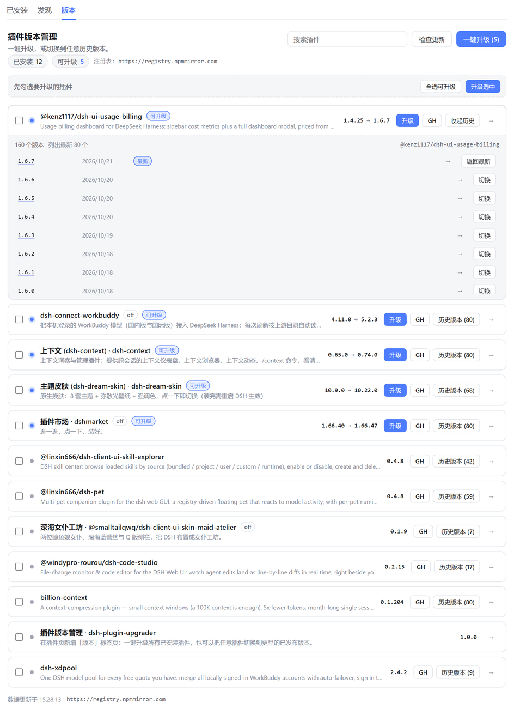
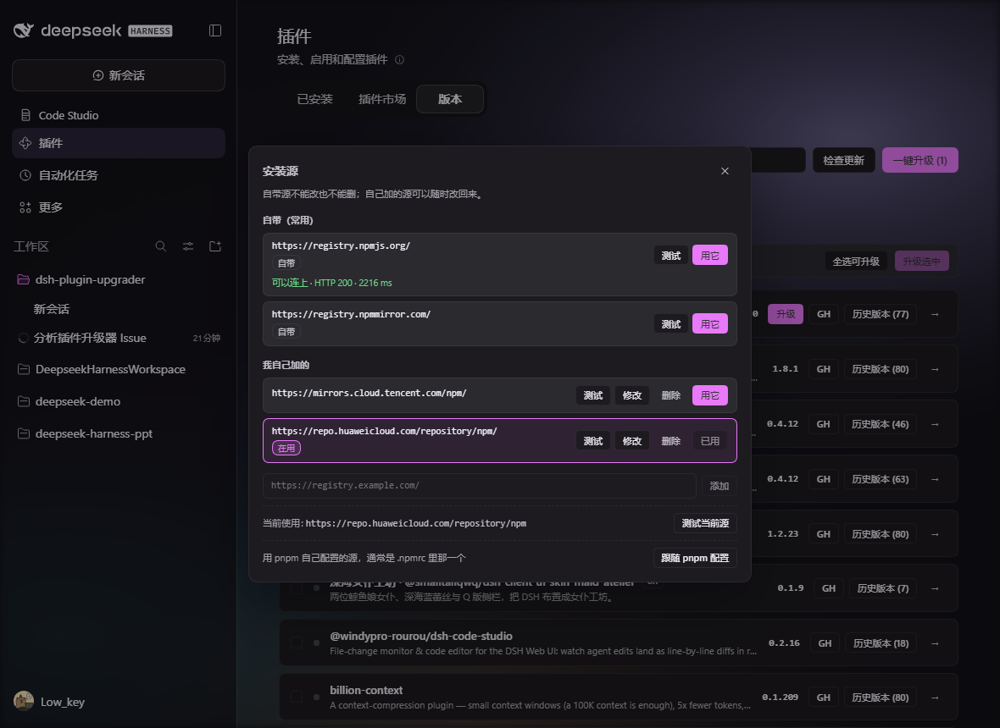
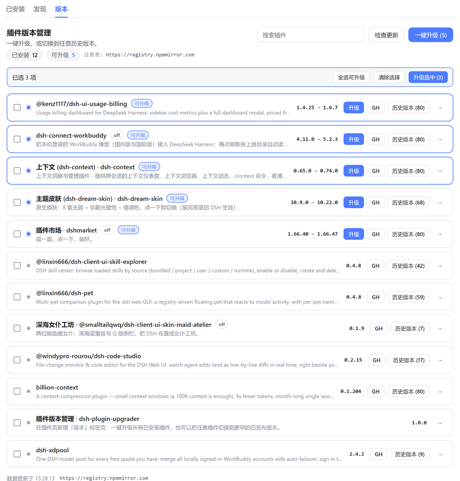

# dsh-plugin-upgrader

[](https://www.npmjs.com/package/dsh-plugin-upgrader)
[](./LICENSE)
[](https://www.dsh.so/artifact/dsh-plugin-upgrader/)
[](https://www.dsh.so/artifact/dsh-plugin-upgrader/)
[](https://dsh.market/)
[](https://deepseekharnessplugins.com/plugins/zuwenyin/dsh-plugin-upgrader)

> 给 DeepSeek Harness（DSH）的「插件」页补上**一键升级**和**版本历史 / 回滚**。

DSH 自带的插件页能装、能卸、能看已安装列表，但缺两件事：一次把全部插件升到最新，以及退回某个旧版本。
这个插件在插件页里加一个「版本」标签，把这两件事补齐。

[English](./README.en.md) · 中文



## 功能

- **一键升级** —— 一次把全部可升级插件升到最新版，带进度、逐项结果和失败原因。
- **升级不卸载** —— 换版本走 in-place 替换，插件不会被卸下来再装回去（详见下文）。
  拿不到 profile 写入锁、或 in-place 那一步被拒时，会退回「先卸载再装」的老路并写明原因。
- **看得见的进度** —— 升级时直接显示 pnpm 的原始输出（含换源重试、lockfile 校验），
  每步都有已用时计时和不确定态进度条，卡住时可以一键取消。
- **多选升级** —— 勾选任意几个插件，只升级选中的这些。
- **版本历史 / 回滚** —— 展开任意插件即可看到已发布的全部版本（含发布时间与引擎要求），点一下切到那个版本。
  每个版本都会先跟你**当前跑的 DSH** 比对一次：装不了的版本会被标出来，切换按钮也是禁用的
  （宿主的兼容性闸门是在 bundle 已经卸下之后才拒绝的，不能让它走到那一步）。
- **一键跳 GitHub** —— 每行的 `GH` 按钮打开插件仓库主页；点版本号直接进该版本的 GitHub 发布页。
- **镜像落后会标出来** —— 配置的镜像还没同步、但上游已经发布的版本会单独标一行，
  而不是假装已经是最新版。
- **自己选安装源** —— 版本页顶部就能切换 npm 源（官方源 / 大陆镜像 / 自己填的私有源），
  选完立刻按新源重读版本列表，升级也走这个源；选择写进 profile，重启和换浏览器都还在。
- **安装源管理** —— 「注册表」按钮打开一个对话框，里面列出自带源、`pluginManager` 配的源
  和用户自己加的源；自带源不能改也不能删，自己加的可以随时改/删。每一行都能单独
  「测试」能不能连上，当前在用的那个也能一键测。
- **要重启时告诉你怎么重启** —— 升级结果里带 `restart-required` 时，提示条上多出一个
  「重启 DSH」按钮，点开说明为什么这次改动要等，并按你的启动方式给出那一条能完成重启的
  操作：桌面版是「退出应用再打开」，命令行启动的是可复制的原命令。确认重启后它会盯着
  宿主的 pid，换了进程才刷新页面，而不是让你对着一个不确定的页面猜。
- **最新版装不了时，给出能装的那个** —— 宿主的兼容性闸门是在 bundle 已经卸下之后才拒绝的，
  所以最新版在你的 DSH 上跑不了时，页面不会只留一行死掉的「升级」：它会算出「高于已装、
  并且这台宿主真的能装」的最高版本，按钮变成「升级到 1.1.0」，批量升级也走这个目标。
  这个推荐**永远不会高于** `latest`，tag 之后发布的预发布版不会被它提拔。
- **「你现在跑的这个」也会不兼容** —— 上面那句话是从最新版算的；如果**已安装**的那个版本
  声明的 DSH 范围在最近一次升级 DSH 之后就出界了，插件很可能根本没被加载，而升级按钮
  救不了它。这种行会单独说一句「已装的 1.0.0 要求 DSH ≥…，当前宿主不满足」。
- **一个能归零的「需处理」数字** —— 顶部统计多一项，只数**这个 profile 里真的出了问题**的
  插件：已装版本不兼容、镜像落后、版本读不到、有构建待批准。点它只列这些行（可以和搜索框
  叠加）。它刻意**不**把「有新版本但装不了」算进去——那不是你能修好的状态，算进去这个数字
  就永远不会归零。
- **一键复制诊断信息** —— 把 DSH 版本、registry、每行插件与它的问题拼成一段 markdown
  贴进 issue，纯客户端完成：不新增路由、不发请求、不新增任何权限声明。
- **页脚写明你跑的是哪个 DSH** —— 这个页面所有兼容性判断都基于它；读不到时会如实说
  「DSH 版本未知」，而不是留空让人以为没问题。



> **要改这个仓库？先读 [AGENTS.md](./AGENTS.md)。** 那里逐条写了「已经实现并且必须继续成立」
> 的行为、对应代码位置和守护它的测试。上面这些功能里，`GH` 链接和 in-place 升级都曾经
> 被无意改掉过一次。

## 界面位置

插件页顶部标签栏多出一个「版本」标签，与「已安装」以及市场标签并列
（市场标签在装了 `dshmarket` 的界面里叫「插件市场」，DSH 自带的那个叫「发现」）：

- 顶部统计：需处理数量 / 可升级数量 / 已安装数量 / 每个插件的版本数
  （「需处理」可以点，点了只看有问题的行；和搜索框能叠加）
- 顶部「注册表」按钮打开安装源对话框：
  - 自带源（官方源、大陆镜像）：只能切过去和测试，不能改也不能删
  - `pluginManager` 里配的源：可以「收进列表」变成自己的常用源，或直接用
  - 自己加的源：可以改、可以删，删掉的如果正在用会自动退回「跟随 pnpm 配置」
  - 每行「测试」同时打 `/-/ping` 和根地址，谁先答应用谁，整次探测 5 秒预算
    （串行探测会把大陆镜像报成连不上：`/-/ping` 有时要 15 秒，根地址只要 0.3 秒），
    结果显示在那一行下面
  - 底部「跟随 pnpm 配置」用 pnpm 自己的源（通常是 `~/.npmrc` 里的那个）
- 「一键升级」升全部可升级插件；下面一条选择栏负责「升级选中」
- 「检查更新」强制刷新 registry 缓存（默认缓存 5 分钟）
- 搜索框按包名过滤
- 页脚写明当前读到的 DSH 版本，以及这次列表是从哪个 registry 读出来的
- 「复制诊断信息」把版本、registry、每一行的问题拼成一段 markdown，贴进 issue 就行
- 每个插件一行，展开「历史 (n)」后是该插件的完整版本列表
- `GH` 打开仓库主页（没有仓库的插件不显示该按钮）
- 版本列表里每个版本号本身就是链接，点开直接进 GitHub 的发布页：
  - 该版本打过 tag → `releases/tag/v<version>`（tag 是否真实存在由 GitHub tag 列表确认，
    不是猜的，所以不会点进 404）
  - 该版本没打 tag，或 GitHub 列表读不到（限流 / 离线）→ 退回仓库的发布列表 `releases`，
    不在页面上放一个点进去是 404 的版本号



## 安装

在「插件」页的市场标签里搜索 `dsh-plugin-upgrader`（自带的是「发现」，
装了 `dshmarket` 的界面里叫「插件市场」），点安装即可。
桌面版请用它自带的插件管理界面安装，命令行改动不了正在运行的桌面 profile。

用 `dsh` 命令行（把 `web` 换成你自己的 profile 名）：

```bash
dsh plugin --profile web add dsh-plugin-upgrader
```

从源码安装：

```bash
git clone https://github.com/zuwenyin/dsh-plugin-upgrader.git
cd dsh-plugin-upgrader
dsh plugin --profile web add "$PWD"
```

装好后打开「插件」页，顶部会多出「版本」标签。不需要重新构建，也不用重启。

## 工作原理

浏览器端读不到 profile 的依赖清单，也无法可靠直连 npm（CORS、私有源、token），
因此所有包操作都放在宿主端：

| 路由 | 作用 |
| --- | --- |
| `GET /api/plugin-upgrader/overview` | 已安装插件 + 各插件已发布版本（registry packument，5 分钟缓存，20 秒超时，最多 4 个并发） |
| `POST /api/plugin-upgrader/job` | 提交一批升级 / 切换步骤，立即返回 job id |
| `GET /api/plugin-upgrader/job?id=…` | 轮询进度、当前阶段、已用时、逐项结果与实时日志 |
| `POST /api/plugin-upgrader/cancel` | 中断当前步骤（任何一次安装，包括退回老路径后的重试） |
| `GET /api/plugin-upgrader/host` | 本进程的 pid 与启动方式，供「重启 DSH」对话框说明怎么重启 |

所有路由仅限本机回环访问：批量操作会安装软件包，配对设备或跨站页面一律拒绝。

### 为什么升级不卸载插件

`pluginManager.installBundle` 对已安装的包名会以 `already-installed` 拒绝，
pnpm 根本不会跑。所以换版本的顺序是：

1. **先直接 `install`**；
2. 被拒绝时，把 profile `package.json` 里那条依赖**临时**摘掉（先写 journal），再 install ——
   pnpm 写回新版本，**插件不被卸载**，加载器里的实例不断，启用状态也不用恢复；
3. 只有第 2 步主动放弃（manifest 读不了 / 拿不到写入锁 / install 失败 / 被拒绝）时，
   才退回 remove + install 的老路径，并在日志里说明是哪一种。

第 2 步改动 `package.json` 时会**拿 harness 自己的写入锁**（`package.json.lock`），
与 `plugin-manager` 用同一把锁：拿不到锁就一秒内放弃、**一个字节都不写**，
然后走第 3 步那条永远正确的老路——比在别人的 read-modify-write 中间插一脚、
把条目弄丢要好得多。

旧版本号会回传给界面，用于提示这是降级。

> 实现在 1.2.0 就有了，但 1.2.0–1.4.0 在桌面端**从未真正生效**：
> `profileDirFrom()` 只认 `DSH_PROFILE_DIR` / `DSH_HOME` + `DSH_PROFILE`，而桌面壳启动宿主时
> 不导出这些变量（它直接把 profile 目录当作子进程的 cwd），于是第 2 步第一行就放弃了，
> 每次升级都悄悄走 remove + install。1.4.1 加了 cwd 回退之后才真正走这条路。
> 细节见 [AGENTS.md](./AGENTS.md) 第 2 条「换版本时**不先卸载**」。

### 升级中断后 profile 还能自己长回来

第 2 步要在「依赖条目已经删掉、新版还没装上」的窗口里改 profile 的 `package.json`。
如果进程正好在这段时间被杀掉，插件就从 manifest 里消失了，等于装不回去。
所以删除之前先写 `package.json.upgrader-journal.json`：下次插件加载时会读它，
manifest 里确实缺这条就补回去，已经装上就只清掉记录，记录和 manifest 对不上就忽略。
恢复失败只是打日志，不会拦住标签页加载。

记录只在**锁内确认条目真的回到盘上**之后才清掉。还原那一步如果拿不到写入锁，
它宁可失败并留下记录，让下次加载再修一次——把记录清了却没能写回去，
才是真的没法自愈。

### enabled 状态保留

卸载会丢掉插件原有的启用 / 禁用状态，因此任何**真的卸载过**插件的步骤都会在装完后
按操作前的状态重新 `setBundleEnabled`（`src/host/install.ts:251` `restoreEnabledState`），
禁用中的插件升级后仍然是禁用状态。in-place 那条路不卸载，所以本来就不需要恢复。

### 为什么升级有时候要好几分钟

不是这个插件慢，是 pnpm 慢。pnpm 11 在 `install` 前会拿锁文件里的每个条目去 registry
重新核对一次（`Verifying lockfile against supply-chain policies`），国内镜像
（`registry.npmmirror.com`）对不少包会 `ETIMEDOUT`，于是走 10 秒 → 1 分钟的重试阶梯。
真正卸载再安装的那种降级路径要跑两条 pnpm 命令，两段各等一次。

旧版本在这里什么都不显示，进度条只在「整步完成」时动一格，所以看起来就是死住了。
现在宿主端订阅了 `plugin-manager/install-log` 和 `plugin-manager/install-state`，
把 pnpm 的原始输出、当前阶段、重试次数实时转进 job 日志，界面同时显示已用时和
不确定态进度条：慢的时候你能看见它在重试，而不是盯着一个不动的 0%。

阶段一共四个：`verifying`（在校验锁文件）→ `installing` → `applying` / `cancelling`。
锁文件校验那一行会连续几分钟不动，单看和「卡死」一样，所以单独给它一个阶段名。

阶段是**按 pnpm 自己的话**判的：manager 是在 pnpm 启动**之前**就上报 `installing` 的，
所以 pnpm 后来的校验行必须还能把阶段改写成 `verifying`，一直到它给出结论
（`✓ Lockfile passes supply-chain policies`）为止。

「还在动」问的是**宿主**，不是 pnpm。pnpm 重试的时候一分钟不打印一行是正常的，
按「日志没变」判停滞会把健康的升级误报成卡住；宿主每 2 秒盖一次心跳，
面板用心跳判定活性，宿主真的不说话了才会说「状态已停止更新」。

顺带修掉的两个坑：

- 心跳改成定时器（2 秒），不再按「完成一步」写。单步超过 15 分钟以前会被误判成
  「job 已放弃」，于是一个健康的任务被作废，还能再并进来一批。
- 退回老路径时那一次重新安装以前用 `requestId: undefined`，导致那一段无法取消；
  现在每次安装都有自己的 id，取消在任何阶段都有效。

### 写入锁超时说人话

profile 的 `package.json` 由 harness 用同目录的 `package.json.lock` 串行化。
manager 自己的预算是 120 秒，而 `atomic-write` 给不写预算的调用方的默认值是 2 秒，
所以偶尔能看到：

```
atomic-write: timed out waiting for the writer lock at …/package.json.lock
```

这句话只报一个文件名和一个 pid，用户无法处理。现在失败信息会先读那把锁，再说清楚是
「另一个操作正在改写，等它结束再试」还是「锁没释放，重启 DSH 会自愈」，
原文放在方括号里保留，方便搜索或贴进 issue。

### 自己那一行不能自己升级

批量升级的第一步是卸载，而卸载的正是此刻在跑的那段代码。所以「一键升级」永远跳过本插件自己，
自己那一行落后时走插件页自己的安装流程；页面没有提供安装入口时明确说一句，
而不是让人点一个必然失败的按钮。

### 同一时刻只跑一批

宿主端一次只允许一个 job。重复提交会拿到 `409 busy`（带正在跑的那个 job id），
界面据此**接管**那一批的进度显示，而不是弹一条看不懂的错误：

- 新开一个插件页标签、或在进度跑着时再点「一键升级」，都会看到正在进行的那一批
- `overview` 里带 `active` 字段，标签页一挂载就能接上正在跑的任务
- job 每 2 秒刷一次心跳时间戳，宿主重启后遗留的「僵尸 job」会按心跳超时自动作废，
  不会永久占着位置让之后所有升级都撞 `busy`

主进程重启会让正在跑的 job 中断，界面会把这种情况显示为失败而不是永远转圈。

## 权限、依赖与外部服务

这一节把插件实际用到的能力写清楚，方便审核和排障时对照，而不是让人去读源码猜。

### 读写什么

| 能力 | 范围 | 说明 |
| --- | --- | --- |
| 文件 | **仅 profile 目录** | 读写 `package.json`、写 `package.json.upgrader-journal.json`、读写并短暂持有 `package.json.lock`。不遍历文件系统，不碰 profile 以外的路径 |
| 网络（出站） | 配置的 npm 源、GitHub API | 只发 `GET`，见下 |
| 命令 | **无** | 不调用 `child_process`，不 spawn 任何进程；安装动作交给宿主的 `pluginManager` |
| 凭据 | **无** | 不读 token，不读 `.npmrc`，不做任何认证。私有源依赖 pnpm 自己的配置 |

安装源的选择（`registry` / `customRegistries`）由**宿主的设置服务**写进 profile 的
`cordis.patch.yml`，不是插件自己改文件——插件只调 `configForms` 的 `set()`。

宿主进程的环境变量只用了 `DSH_PROFILE_DIR` / `DSH_HOME` / `DSH_PROFILE` 三个来**定位 profile
目录**（桌面壳不导出它们时，退回「当前工作目录看起来像不像一个 profile」）。它们不是密钥，但
静态扫描器会把裸 `process.env` 记成一次「凭据」信号，这里说明清楚它的真实用途。

### 外部服务

| 目标 | 用途 | 失败时 |
| --- | --- | --- |
| `{配置的 npm 源}/{包名}` | 拉 packument，列出已发布版本（5 分钟缓存，20 秒超时，最多 4 个并发） | 该行显示 `versionError` 和「重试」，其它行不受影响 |
| `https://registry.npmjs.org/{包名}` | 只当配置的不是官方源时，额外查一次上游，报告「镜像落后」 | 读不到就当作没有缺口 |
| `https://api.github.com/repos/{owner}/{repo}/tags?per_page=100` | 取 tag 列表，判断某个版本号能不能链到 `releases/tag/v…`（30 分钟缓存，8 秒超时） | 退到 `releases` 列表页，绝不猜一个 404 的 tag |
| `{被测试的地址}/-/ping` 与根地址 | 「注册表」对话框里点「测试」时，**并发**探测这两条，谁先 2xx 用谁（整次探测 5 秒预算） | 报最具体的原因：状态码优先，其次超时，最后网络错误原文 |
| 本机 DSH Web 服务 | `/api/plugin-upgrader/*` 自己的五个路由 | — |

默认源是 pnpm 自己配置的那个（通常是 `.npmrc` 里的），也可以在「版本」页的「注册表」按钮里
换成官方源、大陆镜像或自己加的源。**没有任何遥测**，不向第三方发送使用数据。

### 依赖

运行时**没有自带依赖**。唯一的外部模块 `@deepseek-ai/schemastery`（Config schema 用，要求
`~3.18.5`）声明在 `peerDependencies` 里，由宿主提供——DSH 桌面端把它作为自身依赖发布，
`dsh-plugin-manager` 等第一方包也依赖它，所以 profile 里一定解析得到。构建和测试需要的那一份
放在 `devDependencies`。

`devDependencies` 其余各项（TypeScript、esbuild、`@types/*`、`@deepseek-ai/dsh-*`）只在开发和
构建时使用，不会进入发布的 tarball 运行时。

### 失败边界

- **一次只跑一批**：第二个提交拿 `409 busy`，界面接管正在跑的那一批，不报错。
- **job 心跳 2 秒**，15 分钟没进展判废，不会永久占位；主进程重启会中断正在跑的 job，
  界面显示为失败而不是永远转圈。
- **写入锁**：manager 自己的预算是 120 秒，超时会把锁的状态翻成人话（谁持有、要不要重启）。
  in-place 那条路自己也要这把锁，拿不到就在一秒内放弃并改走 remove + install，
  不会去改别人的 manifest。
- **升级失败**：in-place 替换会先把被摘掉的依赖记进 journal，失败就还原；进程被杀掉时，
  下次加载会把依赖补回去。还原时拿不到锁就保留 journal 等下次，不会先把记录清掉。
  失败了插件仍在、启用状态仍在。
- **还原了但没激活**：旧版本装回磁盘、宿主却没把它加载起来时，会明确说「文件在盘上，
  去『已安装』里重新启用」，而不是说「没装、去重装一遍」（重装只会得到 `already-installed`）。
  只有插件真的跑起来了，才算「已还原」。
- **registry 读不到 / GitHub 限流 / 离线**：都降级成「这一项读不到 + 原因 + 重试入口」，
  不会伪装成「没有新版本」「没有历史版本」。

### DSH 兼容性

要求 Node.js `>=20`，DSH `>=0.2.1-rc.3 <0.3.0-0`（`package.json` 的 `engines`）。
`dsh.compatibility.dshReleases` 只记录**真的跑过**的版本：

| DSH 版本 | 状态 |
| --- | --- |
| `0.2.1-rc.5` | compatible |

`0.2.1-rc.4` 和 `0.2.2-alpha.2` 虽然落在 `engines` 范围内，但没有逐一实测过，所以**不写进去**
（未声明的版本按 `unknown` 处理）。这是**来源侧的兼容声明**，不代替逐项的操作验收；
`dshOperations`（install / start / uninstall / rollback）同理，没有逐版本的实测记录就留空，
不写 `passed`。

### 每个版本对不对得上现在的 DSH

DSH 在装插件时会检查插件声明的 DSH 要求，不满足就**拒绝安装**。这个检查发生在版本已经被
摘掉之后（老路径是先卸再装），所以「点了切换，结果插件没了」是真实发生过的事。因此页面自己
先算一遍，规则和宿主完全一致：

- 插件声明了 `engines.dsh` 时，**只看它**，`peerDependencies` 被忽略；
- 否则，`peerDependencies` 里每一个 `@deepseek-ai/dsh`、`@deepseek-ai/dsh-*` 都要满足，
  `workspace:^` / `~` / `*` 视为「就是当前这个运行时」；
- 预发布版本参与比较（`includePrerelease`），与宿主的闸门相同。

两种方向都会标出来：DSH 升级之后想**降级**插件，历史里那些不再接受当前运行时的版本会
被标成「不支持当前 DSH」，切换按钮禁用；DSH 还停在旧版本时想**升级**，如果 `latest`
不接受当前运行时，它就不再算「可升级」，行上会写明它要的是哪个范围。

运行时版本是从**宿主自己的入口**读的，不是从 profile 读的：profile 里的
`@deepseek-ai/dsh-app-boot` 是指向 npx 缓存的链接，实测是 `0.1.2-rc.1`，而宿主真正报的是
`0.2.1-rc.5`。读不到时**什么都不标**——猜一个版本会把本来能装的版本说成不能装。

判定用的是 `src/host/version.ts` 里自己实现的区间匹配，已经在 49 个 range × 41 个版本共
2035 组上跟 `node-semver` 逐一对过（全部一致）。不引入 `semver` 依赖，是因为这条链路上
多一个运行时依赖就多一次供应链审阅，而这里需要的语义只有 `includePrerelease` 那一档。

## 项目结构

```
dsh-plugin-upgrader/
├── AGENTS.md             **改代码前先读**：判据 + 守护测试，每条指向 docs/rules/ 的详证
├── docs/rules/           每条规则的详证页（事故现场、行号核对、原文存档；按需读，不自动加载）
├── src/                  源码（TypeScript）
│   ├── index.ts          宿主端入口：路由注册、job 调度、加载时恢复 manifest
│   ├── host/             宿主端逻辑（Node，无 DOM）
│   │   ├── config.ts     Config schema（volatile 的 registry / customRegistries）、读取用户选择
│   │   ├── overview.ts   组装 overview 载荷（含并发上限）
│   │   ├── registry.ts   registry packument 拉取 / 裁剪、GitHub tag 列表、镜像缺口
│   │   ├── install.ts    单步安装：in-place 替换、remove 回退、enabled 状态恢复
│   │   ├── manifest.ts   profile package.json 读写、journal、加载时恢复
│   │   ├── lock.ts       读 profile 写入锁、在锁内改 manifest、把锁超时翻成人话
│   │   ├── progress.ts   从 pnpm 原始输出推断 job 阶段
│   │   ├── bundle.ts     插件元数据（来源分类、多语言字段、图标）
│   │   ├── repo.ts       仓库 URL 归一化
│   │   ├── version.ts    semver 比较、发布页链接
│   │   ├── http.ts       回环校验、JSON 读写
│   │   └── manager.ts    宿主 pluginManager 服务的最小类型契约
│   └── client/           浏览器端（拆成模块，由 esbuild 打成一个文件）
│       ├── index.ts      createPlugin(require)：槽位注册入口
│       ├── components/   Tab / PluginRow / VersionLine / JobPanel / SourceDialog
│       ├── registry.ts   读写安装源设置、可选源列表的增删改
│       ├── boot.ts       reload 前确认 boot 文档还有效（见 AGENTS.md 第 4 条「不能 reload 进一个已经不存在的 boot 文档」）
│       ├── copy.ts       zh / en 文案
│       ├── styles.ts     作用域 CSS
│       ├── hooks.ts      locale 订阅、overview 拉取、外观插件判定
│       ├── api.ts        fetch 封装、job 轮询
│       ├── format.ts     版本号 / 日期 / 外部链接
│       ├── env.ts        window 上的最小类型声明
│       └── types.ts      载荷类型
├── lib/                  构建产物（**已提交**，见 AGENTS.md 第 13 条「`lib/` 是提交进仓库的」）
│   ├── index.js          宿主端入口（tsc 输出）
│   ├── host/*.js         宿主端模块 + .d.ts
│   └── client.js         浏览器端单文件 bundle（含 __ModuleLoader__ 包装）
├── scripts/build.mjs     构建脚本：tsc 编译宿主端 + esbuild 打包 client（加 --watch 即 dev）
├── scripts/verify-pack.mjs            发布前核对 tarball 里都有什么
├── scripts/verify-build-committed.mjs 核对 `lib/` 与源码一致且已提交
├── test/                 node:test 单元测试（.ts，Node 24 直接剥离类型）
├── locale/               （保留）语言包
├── assets/icon.svg       图标
├── cordis.patch.yml      bundle 注册
└── package.json
```

浏览器端虽然拆成了多个 `.ts` 模块，但最终由 esbuild 打成一个 `lib/client.js`，
外面套上 `window.__ModuleLoader__.load({ id, factory(require) { … } })`。
运行时它只能 `require('react')` 这类由宿主提供的模块，不能 require 自己的其它文件，
所以「拆模块」只发生在源码层，产物仍然是单文件。

## 开发

本项目用 pnpm 管理依赖（`package.json` 里钉了 `packageManager`，CI 也用 pnpm）：

```bash
pnpm install       # 只装依赖（不会构建，见下）
pnpm run dev       # 监听 src/，宿主端和浏览器端改完即编译（Ctrl+C 停止）
pnpm run build     # tsc 编译宿主端 + esbuild 打包 client → lib/
pnpm run typecheck # tsc 检查 src 和 test
pnpm test          # node:test 单元测试（.ts 直接运行）
pnpm run check     # 以上全部（typecheck + build + test + pack 检查 + 产物是否已提交）
```

`lib/` 是**提交进仓库**的，不是构建垃圾：DSH Store 审核固定 commit，不会为了补齐
运行时文件去执行 `prepare`。所以 `pnpm install` 不再触发构建（安装期脚本会被审核
直接否决），构建挂在 `prepack` 上；改完 `src/` 必须 `pnpm run build` 并把 `lib/`
一起提交，`pnpm run check` 会替你核对。详见 [AGENTS.md](./AGENTS.md) 第 13 条
「`lib/` 是提交进仓库的，不是构建垃圾」。

**改任何代码前先读 [AGENTS.md](./AGENTS.md)。** 那里列的是「已经实现、不能再退回」的行为，
每条都附了涉及的符号、守护它的测试名，以及一个 `docs/rules/` 详证页；`pnpm run check` 全绿
只说明没写坏，不说明没改坏（很多行为没有对应测试，比如「自己那一行不出现在批量升级里」
之外的边界情形）。

新增或修改测试后，问一句：**这个测试真的会红吗？** 把被测的字符串或分支临时改成哨兵值
再跑一次，确认它失败，然后改回来。不会失败的测试等于没写。

宿主端在 `src/index.ts`（`webServer` 前缀路由 `/api/plugin-upgrader`），
浏览器端在 `src/client/index.ts`（注册 `plugins.tab` 槽位）。

用户设置有两个：`registry`（当前在用的源，空 = 跟随 pnpm）和 `customRegistries`
（用户自己加的源），都在 `src/host/config.ts` 里声明成 `.volatile()`——这是宿主
设置服务愿意为它生成表单、并且写入能进到正在运行的插件里而不重启的唯一形状。
浏览器端通过 `configForms` 服务读写（`src/client/registry.ts`）；没有那个服务的
宿主照样能渲染这一页，只是源只能看不能改。两个自带源是常量，永远不写进
`customRegistries`，所以没有任何点击能改它们或删它们。

`pnpm run dev` 会并行跑两个监听器：`tsc --watch` 负责 `lib/index.js` 和
`lib/host/**`，esbuild 负责 `lib/client.js`，两者输出互不覆盖。注意 esbuild
打包时会直接剥掉类型而不做检查，所以改浏览器端时顺手跑一次 `pnpm run typecheck`。

改完代码后必须重新构建（profile 里的 `link:` 指向本目录，但加载的是 `lib/`，
不是 `src/`），并把重建后的 `lib/` 一起提交。`pnpm run dev` 已经替你重建了产物，
但**插件本身不会热更新**——要让宿主重新加载本插件，无需重启应用：先
`pluginManager.setBundleEnabled(name, false)` 再 `setBundleEnabled(name, true)`。

## 发布

见 [RELEASING.md](./RELEASING.md)。首次手动发一次，之后打 `v*` tag 由 CI 通过 npm trusted publishing 自动发布：

```bash
pnpm publish --access public   # 仅首次
```

## 许可

[MIT](./LICENSE)
